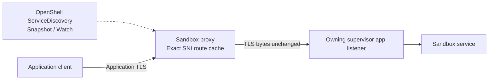

# OpenShell sandbox proxy

A standalone Rust TLS passthrough proxy driven by the OpenShell service discovery
API. It selects the exact discovered hostname from TLS SNI and relays application
TLS directly to the owning supervisor. Application payloads bypass the OpenShell
gateway. Application certificates and private keys stay at supervisors.



The proxy uses the Rust SDK's separate `openshell.v1.ServiceDiscovery` client.
It consumes returned hostnames unchanged, including hashed names. It does not
list sandboxes, reconcile Kubernetes resources, terminate TLS, or carry discovery
credentials into application streams.

## Build and check

Rust 1.95.0 is selected by `rust-toolchain.toml`. Native builds require the AWS-LC
build prerequisites, including a C/C++ toolchain and CMake. Protobuf compilation
uses the SDK dependency's vendored compiler.

```shell
make check
make build
```

`make check` runs formatting, strict all-target Clippy, and tests. OpenShell Rust
SDK, shared types, and test crypto support are Git dependencies pinned to
[`78300dd6424710051654b492a2b0941801aaf07a`](https://github.com/NVIDIA/OpenShell/commit/78300dd6424710051654b492a2b0941801aaf07a).
`Cargo.lock` pins transitive dependencies. No local OpenShell checkout or Go SDK
workspace is required. Update all OpenShell Git dependency revisions together.

## Run

Use a discovery-only certificate with an administrator-managed workspace grant,
or a workspace-authorized bearer identity:

```shell
./target/release/openshell-sandbox-proxy \
  --gateway-endpoint https://gateway.example.com \
  --workspace default \
  --gateway-ca /run/discovery/ca.crt \
  --discovery-client-cert /run/discovery/tls.crt \
  --discovery-client-key /run/discovery/tls.key
```

| Option | Behavior |
| --- | --- |
| `--gateway-endpoint` | Required OpenShell gateway HTTPS origin |
| `--workspace NAME` | One explicit workspace; repeat for a finite set of up to 64 |
| `--all-workspaces` | All active workspaces, including future ones; exclusive with `--workspace` |
| `--gateway-ca PATH` | CA trust for the discovery API; otherwise use SDK system-root behavior |
| `--discovery-client-cert`, `--discovery-client-key` | Discovery mTLS identity; configure together |
| `--discovery-token-file PATH` | Bearer credentials; exclusive with the mTLS identity |
| `--listen-address` | Application TLS listener, default `0.0.0.0:8443` |
| `--health-address` | Health/metrics listener, default `0.0.0.0:9091` |
| `--allow-insecure-gateway` | Explicit credential-free HTTP loopback development only |

Trust and credential files reload on reconnect. Each selection must be fully
authorized; partial selections fail as a whole. Discovery-only identities and
finite/all-workspace requests require the corresponding gateway capabilities.

## OpenShell dependencies

The gateway must enable its supervisor app listener, publish accepted route
advertisements, and expose ServiceDiscovery. These foundational APIs are merged
into OpenShell main. The pinned SDK also includes the discovery-reader additions
from [#4964](https://github.com/NVIDIA/OpenShell/pull/4964); use a gateway with
those changes for discovery-only credentials or finite/all-workspace selections.

[#4956](https://github.com/NVIDIA/OpenShell/pull/4956) supplies the authoritative
application public URLs and shared hostname integration used by this setup.
Provision application DNS and certificates matching the returned hostnames.
Gateway-mediated application routing may be disabled with
`[openshell.gateway].service_routing_enabled = false`. Gateway application auth
from [#4963](https://github.com/NVIDIA/OpenShell/pull/4963) is not required for
this data path. Application authentication remains the ingress/application's
responsibility.

Dedicated and shared supervisors use the same discovery path. On HA takeover,
the proxy routes new connections to the accepted replacement owner; affected
streams close and clients reconnect. The proxy itself needs no Kubernetes API
access or leader election. Replicas maintain independent caches.

## Container and Helm deployment

The Dockerfile builds from source and uses a pinned Debian 13 distroless `cc`
runtime, including the GCC runtime library needed by the Rust binary. It runs as
UID/GID 65532. Build for the cluster architecture:

```shell
make image PLATFORM=linux/arm64 IMAGE=openshell/sandbox-proxy:poc
# For an x86 cluster, use PLATFORM=linux/amd64.
```

Load or push that image through your cluster's normal workflow. Then deploy the
[standalone chart](deploy/helm/openshell-sandbox-proxy/README.md):

```shell
helm upgrade --install app-proxy ./deploy/helm/openshell-sandbox-proxy \
  --namespace openshell \
  --set gatewayEndpoint=https://openshell.openshell.svc:8080 \
  --set workspace=default \
  --set gatewayCASecret=discovery-ca \
  --set clientIdentitySecret=discovery-identity \
  --set image.repository=openshell/sandbox-proxy --set image.tag=poc
```

The discovery CA Secret contains `ca.crt`; the identity Secret contains `tls.crt`
and `tls.key`. Never mount application TLS private keys into the proxy. The
Service maps port 443 to application port 8443. Configure external TCP/TLS
passthrough or a Gateway API passthrough listener, and application DNS, separately.

Allow proxy egress to the gateway discovery API and supervisor app endpoints.
Restrict supervisor ingress if an external ingress applies application access
controls. The proxy never authenticates application users with its discovery
identity. The chart defaults to two replicas and disables ServiceAccount-token
mounting.

Chart validation requires Helm 4 and the `helm-unittest` plugin:

```shell
make helm-check
```

## Cache and connection behavior

Snapshots and watch messages replace complete route views. Reconnects relist;
transient errors retain routes only until their published expiry. Authorization,
configuration, and data-integrity failures clear the cache. Monotonic deadlines
are derived from absolute expiries and capped at 15 seconds; synchronize gateway
and proxy clocks. Revisions are opaque equality tokens, not sequence numbers.

Only exact current routes can dial a backend. Withdrawal, installation/backend
replacement, authorization loss, or expiry closes affected streams. Lease-only
renewals preserve connections. There is no wildcard, gateway payload, or
caller-selected backend fallback. Limits are 4,096 cached routes, 1,024 total
connections, 64 per hostname, a 64 KiB ClientHello, and five-second setup deadlines.

`/healthz` reports process liveness; `/readyz` reports discovery availability;
`/metrics` exposes connection counters. During a transient discovery outage,
readiness fails while unexpired streams can continue; expiry closes them
independently of discovery availability.

Tests cover single/set/all-workspace calls against a server exposing only
ServiceDiscovery, cache validation, TLS byte preservation, renewal, owner
replacement, expiry, unknown SNI, and setup deadlines. Live-cluster, node-loss,
partition, and production-load qualification remain separate from these checks.
